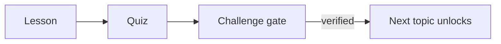
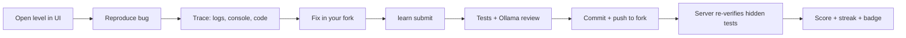

# Bug Hunt - learn real-world debugging by fixing broken microservices

> **Status: design phase.** This repo currently contains documentation only. The app is built phase by phase - see the [Roadmap](docs/ROADMAP.md).
> "Bug Hunt" is a working title.

Tutorials teach you to write code. Production teaches you to **find out why it's wrong**.
Bug Hunt gives you a running app with an intentional bug, and you debug it the way you would at work: reproduce → trace → find root cause → fix → prove it.

## Course-based learning

Bug Hunt is a **course platform with a practical gate**, not just a pile of puzzles.

1. A course is a **roadmap of topics** (e.g. *Spring Boot Debugging → REST basics → Type handling*).
2. You study a topic: lesson, optional quiz.
3. The topic then asks you to **perform a challenge** (a real broken service to fix).
4. Challenge verified → **next topic unlocks**. Repeat to the end of the course, then a capstone incident and a certificate.

Experienced? **Test out**: pass the challenge first and skip the lesson. Details: [docs/COURSES.md](docs/COURSES.md).



## The idea in 30 seconds (one challenge)

1. Open the web UI. Level 1 is a calculator. Enter `2 + 2`, press `=`. It shows **22**. Correct answer: **4**.
2. The UI is fine. The bug is in the backend `add` API.
3. You find the code path (Debug Console, logs, source), fix it.
4. The UI now shows 4.
5. Run `learn submit`. Your tests run, a **local Ollama model reviews your diff**, and your fix is committed and pushed to **your fork**.
6. The platform verifies the pushed commit and records your score and streak in PostgreSQL.
7. Level 1 complete. On to harder bugs: JPA N+1, race conditions, retry storms, SQL injection, memory leaks, "prod is down" incidents.

## How it works



**Principles**
- **Tests decide pass/fail; the AI reviews.** A local LLM is advisory feedback and a capped quality bonus, never the judge.
- **Microservices, not a monolith.** Each service owns its data. See [Architecture](docs/ARCHITECTURE.md).
- **Your machine is untrusted for scoring.** The platform re-verifies your pushed commit.
- **Works offline-first** for learning (local models); exams use institute-hosted infrastructure.

## Features

### For learners
- **Courses and roadmaps:** modules → topics → lesson + quiz + challenge gate; branching prerequisites; progress map; certificates ([Courses](docs/COURSES.md))
- Test-out and placement tests; spaced-repetition review challenges
- 8 level tracks: basics → data/JPA → concurrency → distributed → security → performance → incidents → tooling labs ([Levels](docs/LEVELS.md))
- **Debug Console:** live logs, request inspector, "watch value" tracking, adjustable log level ([Logging](docs/LOGGING.md))
- 3-tier hints that cost points
- **Regression-trap levels:** the obvious fix breaks a hidden case, so only the root-cause fix passes
- AI code review with a rubric (root cause vs symptom patch, side effects, readability)
- Root-cause write-up graded by the local model
- Daily challenge, streaks with freezes, XP, ranks, badges ([Scoring](docs/SCORING.md))
- Tooling labs: stack traces, `git bisect`, SQL `EXPLAIN`, thread/heap dumps, remote debugging
- Replay of your solve (diff timeline)

### For competitions
- Daily, weekly seasons, timed contests, incident races, team contests, private contests
- Live scoreboard with freeze, first-blood, spectator mode, editorials ([Competitions](docs/COMPETITIONS.md))

### For institutes & colleges
- Multi-tenant: institute → department → batch → student; roles for admin, instructor, student
- **Cohorts:** assign a course to a batch with deadlines and drip release; instructor progress dashboard
- Bulk student import, later SSO; custom branding; private level banks
- **Exam mode:** scheduled window + access code, randomized variants per student, locked workspace, server-side timer and grading, similarity reports, CSV/PDF export ([Exams](docs/EXAMS.md))

### For admins
- Append-only, tamper-evident **audit log:** who did what, when, from where
- Per-player timeline, anomaly flags, CSV export ([Logging](docs/LOGGING.md))

## Architecture at a glance

| Service | Role |
|---|---|
| `web` (React + Vite) | Level UIs, Debug Console, leaderboard, admin |
| `gateway` | Entry point, auth, rate limit, correlation IDs |
| `auth-service` | GitHub OAuth, roles, tenants |
| `challenge-*` (Spring Boot) | **The intentionally buggy services you fix** |
| `course-service` | Curriculum, enrollments, topic states, unlock rules, quizzes |
| `progress-service` | Levels, attempts, scoring, streaks, badges |
| `leaderboard-service` | Rankings, seasons, contests |
| `exam-service` | Exams, sessions, grading |
| `audit-service` | Audit events |
| `learn` CLI | doctor, test, review, submit |
| PostgreSQL | One schema per service |
| Ollama | Local code review (`gemma4:12b` default, `mistral` fallback) |

Details, diagrams, repo split: [docs/ARCHITECTURE.md](docs/ARCHITECTURE.md).

## Quick start (planned - not built yet)

```bash
# 1. Fork this repo on GitHub, then clone your fork
git clone https://github.com/<you>/<repo>.git && cd <repo>

# 2. Check your environment (Java, Docker, Ollama, git remote)
./learn doctor

# 3. Start everything
docker compose up

# 4. Open the UI
open http://localhost:3000

# 5. Fix the bug, then
./learn submit L1-001
```

Requirements: Java 21+, Docker, Git, [Ollama](https://ollama.com) with at least one model pulled (e.g. `ollama pull gemma4:12b`).

## Build plan: working app → perfect app

Eleven phases; each ends with something that runs. Full detail and exit criteria: [docs/ROADMAP.md](docs/ROADMAP.md). Pipeline growth per phase: [docs/CICD.md](docs/CICD.md).

| # | Phase | You'll have |
|---|---|---|
| 0 | Foundations | Conventions + docs |
| 1 | Walking skeleton | Level 1 + 2-topic roadmap, end-to-end, by hand |
| 2 | Local submit + AI review | `learn` CLI + Ollama |
| 3 | Persistence, progress & course engine | PostgreSQL, accounts, server-side topic gating |
| 4 | Logging | Debug Console + audit log |
| 5 | Gamification | Score, streaks, hints, badges, leaderboard |
| 6 | Content scale | 3+ courses, 20+ levels, authoring kit |
| 7 | Competitions | Contests, teams, seasons |
| 8 | Institute & exam mode | Multi-tenant exams |
| 9 | Hardening | Sandbox, anti-cheat, observability, SSO |
| 10 | Polyglot & ecosystem | Node/Python tracks, LMS, plugins |

**Start here:** Phase 1. Do not touch Phase 3+ until Level 1 works end to end.

## Documentation

| Doc | What's in it |
|---|---|
| [Architecture](docs/ARCHITECTURE.md) | Services, repo split, flows |
| [Roadmap](docs/ROADMAP.md) | Phases, scope, exit criteria |
| [CI/CD](docs/CICD.md) | Pipeline evolution, environments, rollback |
| [Courses](docs/COURSES.md) | Roadmaps, topics, gating, unlock rules, content format |
| [Levels](docs/LEVELS.md) | Tracks, level spec, Level 1 walkthrough, authoring |
| [Logging](docs/LOGGING.md) | Player Debug Console, admin audit log, observability |
| [Scoring](docs/SCORING.md) | Score formula, streaks, badges |
| [Competitions](docs/COMPETITIONS.md) | Contest types and rules |
| [Exams](docs/EXAMS.md) | Institute multi-tenancy, exam mode, integrity |
| [Database](docs/DATABASE.md) | Schemas and constraints |
| [Security](docs/SECURITY.md) | Threat model, sandbox, anti-cheat |
| [Contributing](CONTRIBUTING.md) | How to contribute code and levels |

## Honest limits
- A local LLM can be wrong or fooled. Treat its review as a coach, not a referee.
- Browser-based exam monitoring is a deterrent, not proof. Humans make the final call.
- Intentionally vulnerable services must never be exposed publicly or connected to real data.

## License
TBD.
