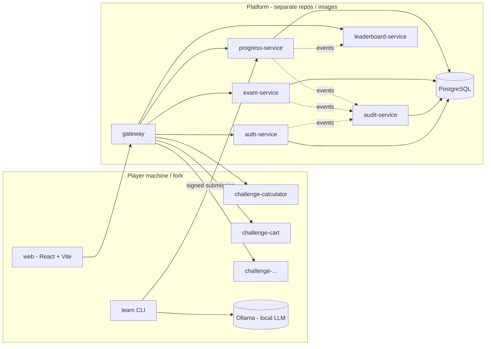
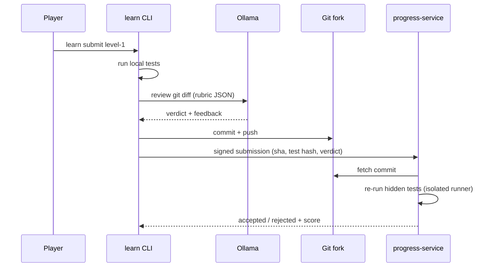

# Architecture

> Status: design. Nothing here is built yet. Build order is in [ROADMAP.md](ROADMAP.md).

## Principles

1. **Microservices, not a monolith.** Each service owns its data and deploys independently.
2. **Players edit only what they should.** Challenge services (intentionally buggy) live in the player's fork. Platform services (auth, progress, exams, audit) are shipped as Docker images so scoring cannot be tampered with.
3. **Tests are the truth; the LLM is a reviewer.** Pass/fail comes from hidden tests. Ollama gives feedback and quality bonus only.
4. **Deterministic tooling does the git work.** The CLI commits and pushes. The LLM only writes summaries.
5. **Exam mode never trusts the player's machine.** See [EXAMS.md](EXAMS.md).

## Component map



## Services

| Service | Lives in | Stack | Responsibility | Owns (schema) |
|---|---|---|---|---|
| `web` | player repo | React + Vite | Level map, challenge UIs, Debug Console, leaderboard, admin/instructor UI | - |
| `gateway` | platform | Spring Cloud Gateway | Single entry, JWT validation, rate limit, correlation ID injection | - |
| `auth-service` | platform | Spring Boot | GitHub OAuth, later SSO; roles; tenant membership | `auth` |
| `challenge-*` | player repo | Spring Boot (one per theme) | **Intentionally buggy** business APIs | none or H2 |
| `progress-service` | platform | Spring Boot | Levels, attempts, completions, scoring, streaks, badges, hints | `progress` |
| `leaderboard-service` | platform | Spring Boot | Rankings, seasons, contest boards | `leaderboard` |
| `exam-service` | platform | Spring Boot | Tenants' exams, sessions, grading, results | `exam` |
| `audit-service` | platform | Spring Boot | Append-only audit events, admin search/export | `audit` |
| `learn` CLI | player repo | Java (or Go) | doctor, test, review, submit | local only |

One PostgreSQL instance, **one schema per service, no cross-schema joins**. Services talk via REST or events, never via another service's tables.

## Repo layout (split by phase, not on day 1)

Phases 0-2: keep everything in this repo. Seven repos on day 1 = pure overhead.
Split at Phase 3, when platform services appear.

```
bughunt-player/        (this repo - what players fork)
  web/
  challenges/<theme>/
  levels/<id>/{level.yaml, bug.patch, hints.md, rubric.md}   # hidden tests are NOT here
  cli/
  docker-compose.yml
  docs/
bughunt-gateway/
bughunt-auth/
bughunt-progress/
bughunt-exam/
bughunt-audit/
bughunt-deploy/        (compose/helm for full platform, env configs)
```

**Open problem:** if hidden tests are shipped in the player fork, players can read them. Options: (a) hidden tests live in `progress-service`'s private runner and execute against the pushed commit; (b) encrypted test bundle fetched per attempt. Decide in Phase 3. Phases 1-2 may ship visible tests; accept that.

## Key flows

### Learning submit



### Exam submit (no local trust)

Student works in an institute-hosted workspace; `exam-service` grades server-side on a locked runner; no Ollama, no hints.

## Cross-cutting

- **Correlation ID:** gateway injects `X-Correlation-Id`; every service logs it. See [LOGGING.md](LOGGING.md).
- **Auth:** JWT (short-lived) + refresh; roles & tenant in claims.
- **Events:** start with synchronous REST + an outbox table; add a broker (Kafka/RabbitMQ) only when needed (Phase 7+).
- **Migrations:** Flyway per service.
- **Config:** 12-factor env vars; no secrets in repo.
