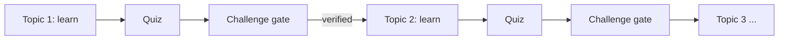

# Courses & Learning Roadmaps

The platform is a **course platform first, challenge platform second**.
Learners follow a roadmap of topics. Finishing a topic's learning material unlocks its challenge. Passing the challenge unlocks the next topic.



## Hierarchy

```
Course            "Spring Boot Debugging"
 └─ Module        "REST & Validation"
     └─ Topic     "Type handling in request payloads"
         ├─ Lesson(s)     markdown, links, code samples, optional video
         ├─ Quiz          optional, pass mark
         └─ Challenge(s)  one or more levels (see LEVELS.md) = the gate
```

A Level (see [LEVELS.md](LEVELS.md)) is the unit of practice. A Topic is the unit of learning. Levels can also be played standalone in "Practice" mode.

## Topic states

| State | Meaning |
|---|---|
| `locked` | Prerequisites not met |
| `available` | Unlocked, lesson not started |
| `learning` | Lesson in progress |
| `challenge` | Lesson (and quiz) done; challenge open |
| `completed` | All required challenges verified server-side |

## Completion rule (per topic, configurable)

A topic is `completed` when **all** are true:
1. Lesson marked as read (and minimum time-on-page, optional).
2. Quiz score ≥ pass mark (if the topic has a quiz).
3. All **required** challenges verified by hidden tests ([SCORING.md](SCORING.md)).

Optional challenges give bonus XP but don't gate.

## Unlock rules

- Default: **linear** within a module.
- Better: **prerequisite graph** (a topic lists `requires: [topic ids]`), so a roadmap can branch (e.g. after "JPA basics" → "N+1" and "Transactions" in parallel).
- Modules unlock when required topics of the previous module are complete.

## Don't frustrate experienced learners

Strict gating punishes people who already know the material. Provide:
- **Test-out:** attempt the topic's challenge first; if verified, the topic is marked complete (lesson stays readable).
- **Placement test** at course start: skips topics proven known.
- Instructors can disable test-out for graded courses.

## Reinforcement

- **Review challenges:** completed topics resurface a short variant after N days (spaced repetition: 3, 7, 21 days). Variant = same bug class, different data/service.
- Weak-topic detection: many hints/failed attempts → suggest revisiting the lesson.
- Course recap quiz and a **capstone incident** (logs-only boss level) at the end of each course.

## Content format (files in the repo)

```
courses/<course-id>/
  course.yaml
  modules/<module-id>/
    module.yaml
    topics/<topic-id>/
      topic.yaml
      lesson.md
      quiz.yaml          (optional)
```

`course.yaml`
```yaml
id: spring-debugging
title: Spring Boot Debugging
level: beginner
estimated_hours: 20
modules: [rest-basics, jpa-data, concurrency]
certificate: true
```

`topic.yaml`
```yaml
id: rest-types
title: Type handling in request payloads
requires: []                 # prerequisite topic ids
lesson: lesson.md
quiz: quiz.yaml              # optional
pass_mark: 70
challenges:
  required: [L1-001]         # level ids from levels/
  optional: [L1-002]
test_out: true
review_after_days: [3, 7, 21]
```

`quiz.yaml`: list of questions (single/multi choice, short answer), explanation per answer, shuffle on/off.

Authors write markdown; no CMS needed at the start. A CI check validates the whole curriculum (see [CICD.md](CICD.md)).

## Learner experience

- **Roadmap view:** visual map (nodes + edges) with state colors; progress % per module/course.
- **Topic page:** lesson → quiz → "Start challenge" button (opens the level, same Debug Console).
- **Resume:** "Continue where you left off."
- **Notes & bookmarks** per topic (later).
- **Certificate** (PDF, verifiable ID) on course completion.

## Features this enables

| Feature | Description |
|---|---|
| Learning paths | Curated multi-course paths (e.g. "Backend debugging engineer") |
| Course catalog | Browse, enroll, difficulty and time estimates |
| Cohorts | Instructor assigns a course to a batch with a deadline; progress dashboard |
| Course-scoped exams | Exam draws from topics/levels of a course ([EXAMS.md](EXAMS.md)) |
| Course leaderboards | Rank within a course or cohort |
| Prerequisite courses | Course B requires Course A certificate |
| Drip release (institutes) | Topics open on dates set by the instructor |

## Authoring workflow

1. Define roadmap: `course.yaml` + module/topic list (titles and `requires` only).
2. Write each topic's `lesson.md`.
3. Attach existing levels or author new ones ([LEVELS.md](LEVELS.md)).
4. Add quiz (optional).
5. CI validates links, prerequisites (no cycles), referenced levels exist and are solvable.
6. Peer review; publish by merging to `main`.

## Open decisions
1. Linear-only first, or prerequisite graph from day 1? Recommendation: store `requires` from the start; UI can render linear until branching is needed.
2. Lessons as markdown in repo (versioned, PR-reviewed) vs DB/CMS. Recommendation: repo first; DB-backed editor only when non-developers must author.
3. Video: link out (YouTube/Vimeo) rather than hosting.
